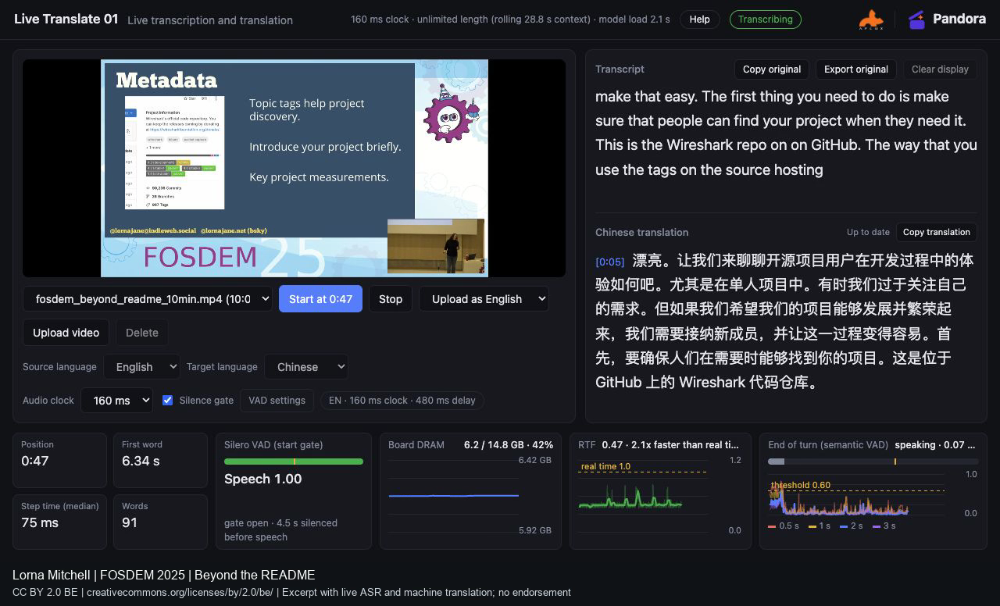

# Live Translate 01

On-device live transcription and streaming translation for video playback.
The original transcript updates continuously; translated text follows the same
paragraphs and timestamps. Short translation tasks stream into each paragraph.

- Chinese and English speech transcription.
- Target languages: Chinese, English, Japanese, Korean, French, German, Spanish,
  Arabic and Thai. Source and target must differ.
- Video-language records fill the source selector; the selected language can be
  corrected and saved. This is not automatic spoken-language identification.
- Video upload, original-text export, translation copy, stop/drain and session reset.
- A standalone Python audio example using the same delivered component SDKs.

The application reuses existing transcription and translation packages from
[Live Transcribe 01](https://huggingface.co/APLUX-Pandora/live-transcribe-01) and
[Multilingual Translation 01](https://huggingface.co/APLUX-Pandora/multilingual-translation-01).
No separate model repository is required. Repository access is required to download
the current model packages. Supply an audio/video file you are authorized to use;
input lecture files are not bundled with the application.

## One-minute demonstration

[](docs/demo.mp4)

[Higher-quality recording](docs/demo-original.mp4)

English speech is transcribed and translated into Chinese in real time. The
recording uses Lorna Mitchell's FOSDEM 2025 talk, *Beyond the README*, under
CC BY 2.0 BE. It includes an attribution footer and the final translation drain.
See [media attribution](docs/MEDIA_ATTRIBUTION.md) for source, license and editing details.

## Supported hardware

Qualcomm QCS8550, Linux AArch64, with the 160 ms transcription package. The composite
has not been qualified on other chips or with the 80 ms transcription package.

## Install

Use Python 3.10 on the board. The native SDKs require the separately installed
AidLux AidLite/QNN 2.48 and AidGen runtimes; runtime setup is independent of Python.
The tested platform uses AidLite 2.5.0.284 and AidGen 2.4.4.171. Ask your platform
administrator for matching supported runtime packages rather than replacing a
shared board runtime. Video upload/playback requires system `ffmpeg` and `ffprobe`.

```bash
git clone git@github.com:APLUX-Pandora/live-translate-01.git
cd live-translate-01
python3 -m venv .venv
.venv/bin/python -m pip install --upgrade pip setuptools
.venv/bin/python -m pip install -r requirements.txt
.venv/bin/python -m pip check
# Set HF_TOKEN in the current shell using an account with model-repository access.
.venv/bin/python tools/download_models.py
.venv/bin/python tools/download_models.py --verify-only
```

The downloader uses fixed revisions and validates hashes before reusing local files
or completing downloads. It preserves both original model repositories. The layout
is `models/asr/qnn248_qcs8550/manifest.json` and
`models/translation/qcs8550/manifest.json`. See [model resources](resources/README.md).

## Run the Web demo

```bash
bash demo/run.sh --port 8766
```

Open `http://<board-address>:8766`. Choose the video's spoken language in the upload
selector and upload a video. The saved language record fills Source language;
correct it if needed, choose a different Target language, and press Start.
Stop finishes accepted audio and its remaining translation. Language controls
unlock after that work finishes. Starting again or seeking starts a new session.
The browser captures the audio from video playback; plain HTTP uses the supported
ScriptProcessor fallback when AudioWorklet is unavailable.

Default package discovery requires exactly one package under each model container.
A flat manifest directly in each container is also supported. With multiple
packages, select the actual package roots explicitly:

```bash
bash demo/run.sh --models models/asr/qnn248_qcs8550 \
  --translation-models models/translation/qcs8550
```

An invalid explicit path never falls back to another package.

## Integrate in Python

```bash
.venv/bin/python examples/python/translate_audio.py path/to/audio.wav \
  --source en --target fr --realtime
```

See [the standalone example](examples/README.md), [integration contract](docs/INTEGRATION.md),
[transcription SDK](sdk/README.md) and [translation SDK](components/translation/sdk/README.md).
The example does not start the Web service. Both interfaces invoke the same native
component libraries; no model algorithms are implemented in the Web layer.

## License

See [LICENSE](LICENSE), [LICENSING.md](LICENSING.md) and [NOTICE](NOTICE). SDK binaries,
models, brand assets and external vendor runtimes retain their scoped terms and
required third-party attributions.
